<a href="https://crawlcove.com/download?utm_source=github&utm_medium=readme&utm_campaign=claude-seo-plugin"></a>

# claude-seo-plugin

A **Claude SEO plugin** for Claude Code. Ask Claude "audit example.com", "what links to my 404s?" or "write meta descriptions for the pages that have none", and get answers from a real crawl of the site with the affected URLs and the fix for each. It gives Claude seven SEO skills and a small crawler that runs on your computer.

```
/plugin marketplace add CrawlCove/claude-seo-plugin
/plugin install crawlcove-seo@crawlcove
```



*The bundled crawl server answering the `crawl_site` call Claude makes, run through the MCP Inspector CLI against [seo-test-site](https://github.com/CrawlCove/seo-test-site), a public site full of planted SEO problems.*

Things to ask once it is installed:

- "Crawl https://example.com and tell me what to fix first."
- "Find the broken links and tell me which page each one is on."
- "Which pages have duplicate or missing titles? Draft a new title and meta description for each."
- "Why isn't /pricing indexed?"
- "Write Product schema for this page and check it against what Google requires."
- "Can ChatGPT, Claude and Perplexity read my site? Check robots.txt for their crawlers."
- "Compare staging.example.com with the live site before we launch."

## What it does

- **Seven skills**: step-by-step SEO playbooks Claude follows, so an audit comes back prioritised by what loses traffic first, not as a flat list of warnings.
- **Six crawl tools**, served by a bundled local MCP server: crawl a site (same-origin, breadth-first, robots.txt respected, up to 200 pages), or load a crawl export from disk, then query the issues, pages and broken links.

The skills use the crawl tools when they are available and say so. Where they are not (see [Where each part works](#where-each-part-works)), the skills work from pages you paste or that Claude can fetch, state how many pages they have seen, and do not make up site-wide numbers.

## Install

In Claude Code:

```
/plugin marketplace add CrawlCove/claude-seo-plugin
/plugin install crawlcove-seo@crawlcove
```

The crawl tools start with the plugin; there is nothing else to install or configure. It is not listed in Anthropic's plugin directory yet, so the two commands above install it straight from this repository.

## The skills

| Skill | What it does |
|---|---|
| `seo-audit` | Crawls the site, groups the issues by impact and returns the top fixes with affected URLs, ending in a prioritised task list. |
| `technical-seo` | Checks indexability and crawlability: status codes, redirect chains, canonicals, noindex, robots.txt, and the sitemap against the crawl. |
| `broken-links` | Lists 404s and redirect chains as source page -> target, with the edit to make on each source page. |
| `on-page-seo` | Finds missing, duplicate and too-long titles, meta descriptions and H1s, then drafts replacements from each page's own content. |
| `schema-markup` | Checks a page's structured data and writes JSON-LD for its page type against what Google requires for rich results. |
| `ai-search-visibility` | Checks AI crawler access in robots.txt (GPTBot, OAI-SearchBot, ClaudeBot, PerplexityBot and others), whether content is in the server HTML, and how quotable the key pages are. |
| `site-migration-check` | Compares staging with live, or before with after, and lists what would lose traffic at launch. |

Claude picks a skill from what you ask. You can also call one by name, for example `/crawlcove-seo:seo-audit`.

## The crawl tools

| Tool | What it does |
|---|---|
| `crawl_site` `{url, maxPages?, ignoreRobots?}` | Live crawl of a site: same-origin links only, breadth-first, robots.txt respected, default 50 pages, hard cap 200. The result becomes the active dataset. |
| `load_export` `{path}` | Loads a Crawl Cove desktop app JSON export or a `crawlcove-cli` JSON result from disk. No page cap. |
| `get_issues` `{type?, limit?}` | The SEO issues in the active dataset. Types: `broken-page`, `missing-title`, `long-title`, `duplicate-title`, `missing-meta-description`, `long-meta-description`, `missing-h1`, `multiple-h1`, `noindex`, `redirect-chain`, `missing-canonical`. |
| `get_page` `{url}` | Everything recorded about one URL: status, final URL and redirect hops, title, meta description, H1 count, canonical, robots meta, broken links out. |
| `list_broken_links` `{limit?}` | Broken internal links as source page -> broken target, so you know which page to edit. |
| `list_pages` `{status?, indexable?, urlContains?, limit?}` | Pages with status, indexability and title, filtered. |

All six are read-only: they fetch pages and read a file you name, and change nothing. Answers are capped at about 25,000 characters; a longer list ends with a line saying how many rows were left out and which argument narrows it.

What the crawler records per page: HTTP status, redirect hops and final URL, title, meta description, H1 count, canonical, robots meta, and links to internal pages that turned out broken. It reads the HTML the server sends and does not run JavaScript. It does not check external links, images, structured data, hreflang, page speed or `X-Robots-Tag` headers.

## Where each part works

| | Skills | Crawl tools |
|---|---|---|
| Claude Code | Yes | Yes |
| Cowork sessions on your computer | Yes | Yes |
| claude.ai chat (web, desktop chat, mobile) | Yes | No |

Chat on claude.ai does not run a plugin's local MCP server, so there the skills work in page mode: you paste pages or Claude fetches them, and Claude tells you it has seen those pages and not the whole site.

## What it runs and sends

- It starts one local Node process (`node server/cli.mjs`) on your computer, for as long as Claude keeps it open. The code is the plain JavaScript in [`server/`](server/), with no dependencies and no build step.
- That process makes network requests only when Claude calls `crawl_site`. It fetches the site you asked it to crawl and that site's `robots.txt`, from your machine and your IP address. It stays on the site's origin when following links. If a page on the site redirects to another address, it follows the redirect to record where it ends.
- It reads a file only when Claude calls `load_export` with a path, and it reads only that file.
- No telemetry, no account, no API key. Nothing is sent to Crawl Cove or to any third party. Crawl results stay in the process's memory and go to Claude as tool results, and are gone when the process exits.
- As a crawler it identifies itself as `crawlcove-cli/1.1.4 (+https://crawlcove.com/open-source/crawlcove-cli)`, obeys `robots.txt` (a `User-agent: crawlcove-cli` group, else `*`), makes at most 4 requests at a time and stops at 200 pages. `ignoreRobots` is off unless you ask for it, and is meant for sites you own.

## Requirements

Node.js 18 or later on your PATH. Nothing else.

## Works with Crawl Cove

[Crawl Cove](https://crawlcove.com/?utm_source=github&utm_medium=claude-seo-plugin) is a desktop SEO crawler. The crawler bundled here stops at 200 pages. For bigger sites, crawl history, Search Console data beside the crawl, or bulk fixes, use the desktop app: its Free plan covers 1 project and 1,000 URLs a crawl (£0). A JSON export from the app loads into this plugin with `load_export` and has no page cap.

The plugin works without the app.

## Related tools

<!-- related:start, kept in step by CrawlCove/.github scripts/related.mjs -->
| Repo | What it does |
|---|---|
| [seo-crawler-cli](https://github.com/CrawlCove/seo-crawler-cli) | Crawl a site from a script or CI. Checks status codes, redirect chains, titles, meta descriptions, H1s, canonicals, noindex and broken links, and fails the build on regressions. |
| [seo-audit-action](https://github.com/CrawlCove/seo-audit-action) | Crawl a staging or preview URL on every pull request. Fails the check on broken links, missing titles, noindex and redirect chains, with the details as a PR comment. |
| [seo-mcp-server](https://github.com/CrawlCove/seo-mcp-server) | Crawl a site, list SEO issues, inspect pages and find broken links from inside Claude, Cursor and other AI assistants. |
| [seo-chrome-extension](https://github.com/CrawlCove/seo-chrome-extension) | On-page SEO checker with an AI visibility report: which AI crawlers can read the page, snippet blocks, llms.txt and extractability. Nothing leaves the browser. |
| [xml-sitemap-validator](https://github.com/CrawlCove/xml-sitemap-validator) | Check a sitemap or sitemap index against the sitemaps.org protocol and search engine limits. Flags bad URLs, lastmod dates and cross-host entries. |
| [robots-txt-tester](https://github.com/CrawlCove/robots-txt-tester) | Fetch and lint a robots.txt, test which URLs each crawler may fetch and see the deciding line. Fails deploys that block the site. |
| [redirect-chain-checker](https://github.com/CrawlCove/redirect-chain-checker) | Follow every hop of a URL's redirects and flag chains, loops, HTTPS downgrades, meta refreshes and redirects to error pages. |
| [hreflang-checker](https://github.com/CrawlCove/hreflang-checker) | Validate the hreflang tags on a page or across a whole XML sitemap, including self-reference, x-default and return tags. |
| [schema-markup-validator](https://github.com/CrawlCove/schema-markup-validator) | Check every schema.org node on a page against the required and recommended properties for rich results. |
| [seo-test-site](https://github.com/CrawlCove/seo-test-site) | A deliberately broken SEO test site with every planted problem and its expected finding listed, for testing any SEO crawler. |
| [seo-crawl-export-spec](https://github.com/CrawlCove/seo-crawl-export-spec) | An open format for site crawl data: JSON Schema and CSV column reference, with a real sample export and a validator script. |
| [seo-crawl-export-js](https://github.com/CrawlCove/seo-crawl-export-js) | Load, query and convert site crawl data in JavaScript and TypeScript, with typed pages, issues by type and status filters. |
| [screaming-frog-export-converter](https://github.com/CrawlCove/screaming-frog-export-converter) | Turn an SEO Spider internal_all.csv into the open JSON crawl export format, with a report of which columns carried over. |
| [seo-audit-google-sheets](https://github.com/CrawlCove/seo-audit-google-sheets) | An Apps Script add-on that turns a site crawl export into an audit workbook: pages, issues by type, pages by status and title and meta flags. |
| [wordpress-seo-connector](https://github.com/CrawlCove/wordpress-seo-connector) | Bulk-apply fixes from the Crawl Cove desktop crawler to Yoast SEO, Rank Math, SEOPress or AIOSEO, with a change log and one-click revert. |
<!-- related:end -->

## Development

```sh
node --test                 # the whole suite; no install step, there are no dependencies
claude plugin validate .    # checks the plugin and marketplace manifests
node server/cli.mjs         # run the MCP server by hand; it speaks JSON-RPC on stdin/stdout
```

Layout:

- `.claude-plugin/plugin.json`, `.claude-plugin/marketplace.json`: the plugin and its one-plugin marketplace.
- `.mcp.json`: starts `server/cli.mjs` as a stdio MCP server.
- `server/`: the MCP server. `protocol.mjs` is the JSON-RPC layer, `tools.mjs` the six tools, `dataset.mjs` the pure queries, `crawler/` the crawler.
- `skills/<name>/SKILL.md`: the seven skills.
- `tests/`: `node:test` suites, with a local HTTP fixture server. No test touches the network.

To try a local checkout in Claude Code: `claude --plugin-dir /path/to/claude-seo-plugin`.

## Licence

MIT. See [LICENSE](LICENSE).
